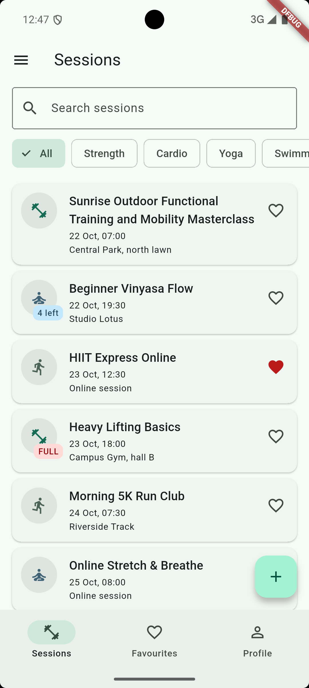
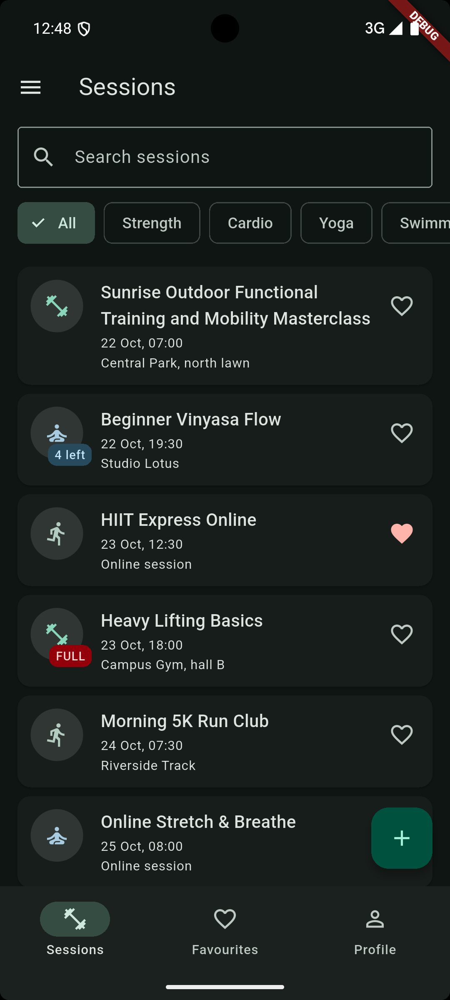
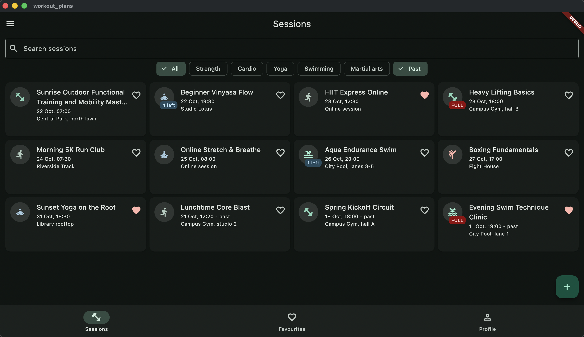

# Workout Plans

A multi-screen Flutter app for a workout club (Lab 1, Mobile Development).

**Domain:** workout plans. A *session* has a title, a category (strength, cardio,
yoga, swimming, martial arts), a start time, a place (or a link when the session
is online), a participant limit, a list of participants, an optional description
and a favourite flag. "Join" adds your name to the session until the limit is reached.
All data lives in memory.

## Screenshots

| Phone, light | Phone, dark | Tablet, grid |
| --- | --- | --- |
|  |  |  |

## Decisions

The session list and the profile live in the State of the shell, because three tabs and two pushed screens read the same data and there is no shared state yet; tabs get plain values and report changes through callbacks.
The detail screen receives the session and callbacks in its route arguments, so it stays a view that never reaches into the shell and can be opened for any session.
The form receives a nullable `Session` and returns a new `Session` through `pop`, so one screen serves both create and edit, and the caller handles the result with a single null check, which makes backing out change nothing.
The list becomes a grid through a `LayoutBuilder` instead of `MediaQuery`, because the widget should react to the space it is given by its parent and not to the size of the whole window.
`PopScope` compares the current form values with a snapshot taken when the form opened, so only a real change asks "Discard changes?" and typing a letter and deleting it does not.
The countdown is a sealed class rendered by an exhaustive `switch`, so adding a new state breaks the build until every screen handles it.
With the tools of week 9 I would move the list into one shared object with persistence, so callbacks would no longer be passed through three layers.
